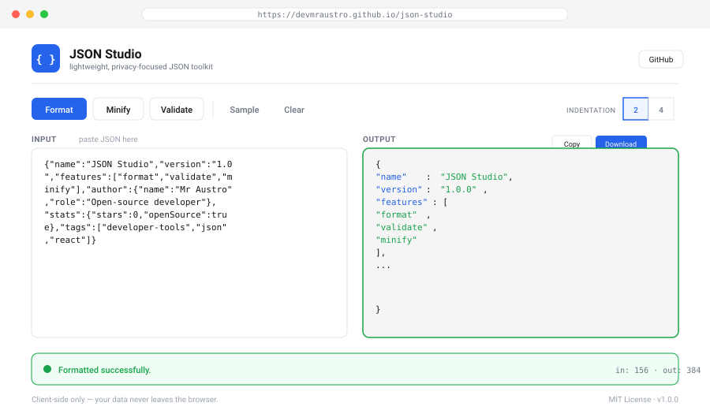
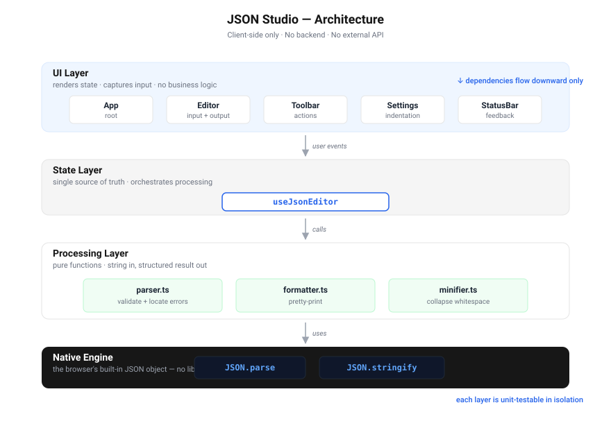
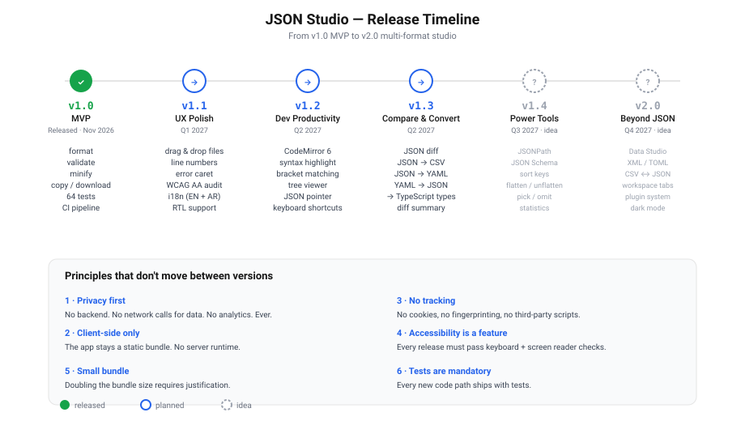

<p align="center">
  
</p>

<h1 align="center">JSON Studio</h1>

<p align="center">
  A lightweight, privacy-focused JSON toolkit for developers.<br/>
  Format, validate, minify, and export JSON directly in your browser — no backend, no tracking, no account.
</p>

<p align="center">
  <a href="https://github.com/Devmraustro/json-studio/blob/main/LICENSE"></a>
  
  
  
</p>

---



## Features

- JSON formatter with 2 or 4 space indentation
- JSON validator (strict RFC 8259 — no comments, no trailing commas)
- JSON minifier
- Copy to clipboard with fallback
- Download as `.json`
- Sample data button
- Clear editor
- Error feedback with line/column when available
- Responsive UI (desktop + mobile)
- 100% client-side

## Privacy

Everything runs in your browser. There is no backend, no network call for processing, no analytics, and no automatic persistence of your input. If you are working with sensitive data, always follow your organisation's security guidelines.

## Tech Stack

React 18, TypeScript 5 (strict), Vite 5, Vitest 2, React Testing Library, ESLint, plain CSS.

## Architecture



Four layers, dependencies flowing downward only. See [`docs/architecture.md`](docs/architecture.md) for the full design notes.

## Getting Started

Requires Node.js LTS and npm.

```bash
git clone https://github.com/Devmraustro/json-studio.git
cd json-studio
npm install
npm run dev
```

Open the URL printed by Vite (default `http://localhost:5173`).

## Scripts

| Script                  | Description                              |
| ----------------------- | ---------------------------------------- |
| `npm run dev`           | Start the dev server                     |
| `npm run build`         | Type-check and build for production      |
| `npm run preview`       | Preview the production build             |
| `npm test`              | Run all unit and component tests         |
| `npm run test:watch`    | Watch mode                               |
| `npm run test:coverage` | Coverage report                          |
| `npm run lint`          | Lint `.ts` and `.tsx`                    |
| `npm run lint:fix`      | Auto-fix lint issues                     |
| `npm run typecheck`     | `tsc --noEmit`                           |

## Project Structure

```
json-studio/
├── assets/                # logo, badge, diagrams
├── public/
│   └── favicon.svg
├── src/
│   ├── app/               # App.tsx, main.tsx
│   ├── components/        # Editor, Toolbar, StatusBar, Settings
│   ├── features/json/     # parser, formatter, minifier, types
│   ├── hooks/             # useJsonEditor
│   ├── styles/            # global.css
│   └── utils/             # download.ts
├── tests/                 # parser, formatter, minifier, editor, download
├── docs/architecture.md
├── ROADMAP.md
└── ...
```

See [`docs/architecture.md`](docs/architecture.md) for design notes and [`ROADMAP.md`](ROADMAP.md) for the full version plan.

## Testing

```bash
npm test
```

Covers the parser (valid, invalid, primitives, nested, unicode, escaped), formatter (2/4 indent, nested, primitives), minifier (whitespace removal, nested, already-minified), and the editor integration (format, minify, validate, sample, clear, indentation, copy).

## Security

See [`SECURITY.md`](SECURITY.md). In short: no backend, no network calls, no `innerHTML`, no analytics, no committed secrets.

## Roadmap



**v1.0 (current):** format, validate, minify, copy, download, sample, clear, error feedback, responsive UI, tests, CI.

**Coming next:**
- **v1.1** — UX polish: drag-and-drop files, line numbers, accessibility audit, i18n (EN + AR)
- **v1.2** — Developer productivity: CodeMirror 6, JSON tree viewer, keyboard shortcuts
- **v1.3** — Compare & convert: JSON diff, CSV/YAML/TypeScript export
- **v1.4** — Power tools: JSONPath queries, JSON Schema validation, statistics
- **v2.0** — Beyond JSON: multi-format studio, workspace tabs, plugin system, dark mode

See the full [`ROADMAP.md`](ROADMAP.md) for details.

## Deployment

`npm run build` produces static assets in `dist/`. Host on GitHub Pages, Vercel, Netlify, or Cloudflare Pages.

## Contributing

See [`CONTRIBUTING.md`](CONTRIBUTING.md).

## License

MIT — see [`LICENSE`](LICENSE).

## Author

Mr Austro — built as an open-source developer tool project.
