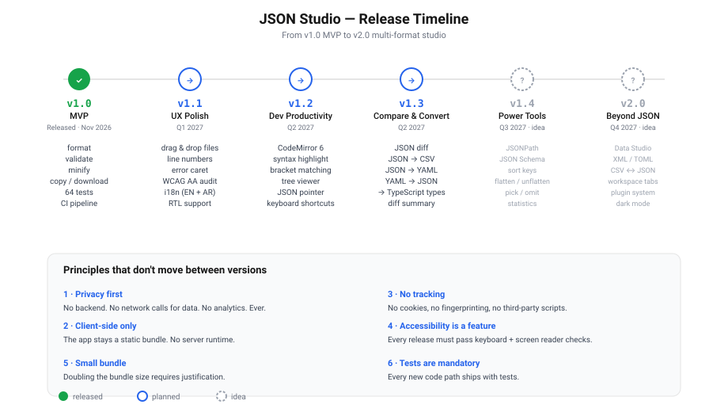

# Roadmap

Where the project is, where it's going, and what it won't become.

---

## Where we are now

### v1.0 — shipped on Nov 25, 2026

The MVP is done. The app does what the README says it does, the tests pass, and the CI runs on every push.

What's in:

- Format, minify, validate — all on a strict RFC 8259 parser
- 2 or 4 space indentation, picked from a segmented control
- Copy and download, with a fallback for the clipboard API
- Sample data button, clear button
- Error messages with line and column when the engine gives them
- A status bar with byte counts
- Responsive layout (collapses to one column on mobile)
- 64 tests covering the engine and the editor
- ESLint clean, TypeScript strict, CI green

What's not in, on purpose:

- No backend, no network calls, no analytics
- No persistence — close the tab, the data is gone
- No syntax highlighting (planned for v1.2)
- No tree view (planned for v1.2)
- No dark mode (planned for v2.0)

---

## What's next

### v1.1 — UX polish

Target: Q1 2027

The MVP works, but it feels like a textarea. The next release makes it feel like a tool.

- Drag a `.json` file onto the input pane instead of pasting
- Line numbers in the input
- When parsing fails, show a snippet of the broken line, not just the column number
- Tab key inserts spaces (instead of stealing focus)
- Word-wrap toggle for long lines
- Detect duplicate object keys and warn
- Full keyboard navigation, visible focus, ARIA live region on status
- WCAG AA audit with NVDA and VoiceOver
- Pull all UI strings into a locale file, ship English and Arabic, support RTL

### v1.2 — Developer productivity

Target: Q2 2027

Where the editor stops being a textarea.

- Replace the textarea with CodeMirror 6
- JSON syntax highlighting (keys, strings, numbers, booleans, null)
- Bracket matching and auto-closing
- In-editor search (Ctrl+F)
- A collapsible tree view next to the text output
- Click a node in the tree, see its source range highlighted
- Path bar showing the JSON pointer of the current selection (`$.users[0].name`)
- Copy-path action on every node
- Keyboard shortcuts: `Ctrl+Shift+F` format, `Ctrl+Shift+M` minify, `Ctrl+Shift+V` validate, `Ctrl+Shift+S` sample, `Ctrl+Shift+C` copy, `Ctrl+Shift+D` download, `Ctrl+Shift+K` clear
- `?` opens a shortcut cheatsheet

### v1.3 — Compare and convert

Target: Q2 2027

Two big things people ask for: diffing two JSON documents, and getting JSON into other formats.

- Side-by-side diff view
- Inline additions, deletions, and modifications highlighted
- Path-level summary: "5 keys added, 2 changed, 1 removed"
- Ignore-key option (skip `timestamp`, `updatedAt`, etc.)
- JSON to CSV for arrays of homogeneous objects
- Nested objects flattened with dot-notation headers (`address.city`)
- CSV preview before download
- Configurable delimiter (comma, semicolon, tab)
- JSON to YAML and back, key order preserved
- JSON to TypeScript `interface` declarations, with union types when array items differ

### v1.4 — Power tools (idea, not committed)

Target: Q3 2027

This version exists on the roadmap to gauge interest. None of it is built, and none of it is promised.

- JSONPath queries against the input, live preview as you type
- Highlight matched nodes in the tree viewer
- JSON Schema validation (draft 2020-12)
- Generate a stub schema from a sample
- Sort object keys alphabetically, with a recursive option
- Flatten nested objects into dot-notation, and unflatten back
- Pick or omit keys by name
- Encode all string values (base64, URL)
- Statistics: bytes, keys, array items, max depth, key frequency, type distribution

### v2.0 — Beyond JSON (idea, not committed)

Target: Q4 2027

If v1.x goes well, the natural next step is to handle more than JSON. The name would change to **Data Studio**, and the JSON-specific tools would become one tab among many.

- XML formatter and validator
- TOML reader
- CSV and JSON, two-way
- Markdown table and JSON, two-way
- Multiple tabs (one document per tab)
- Optional session restore, off by default (privacy)
- Export the workspace as a `.zip`
- Optional passphrase-encrypted local storage, off by default
- Plugin system: user-defined transforms in a small JS sandbox
- Plugin manifest format (`plugin.json`)
- Community plugin registry, static, no backend
- Dark mode, system-preference-driven, manual toggle, token overrides only

---

## What this project won't become

A few things are off the table, regardless of how many people ask:

1. **No backend.** The app stays a static bundle. If a feature needs a server, the feature doesn't ship.
2. **No tracking.** No analytics, no cookies, no fingerprinting, no third-party scripts.
3. **No accounts.** No sign-up, no login, no user database. Ever.
4. **No large dependencies without justification.** Adding a 200 KB library for a minor convenience is not a trade we'll make.
5. **No breaking changes inside v1.x.** Save formats, keyboard shortcuts, and the public API stay stable until v2.0.

---

## How to influence the roadmap

- Open an issue with the `roadmap` label to propose a feature.
- Add a 👍 to existing issues. We use reactions to read demand.
- If you want to implement something from the "planned" list above, comment on the relevant issue first so we can align on the approach before you write code.

---

## Versioning

- **Patch** (`1.0.x`): bug fixes, no behaviour change.
- **Minor** (`1.x.0`): new features, backwards-compatible.
- **Major** (`x.0.0`): breaking changes. Reserved for v2.0 and beyond.

Pre-releases use `-alpha.N`, `-beta.N`, `-rc.N` suffixes.
